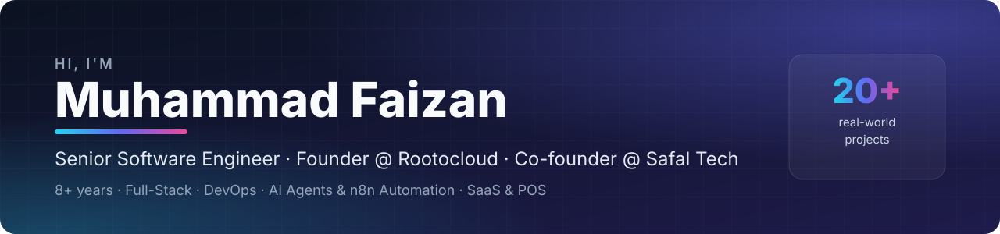

  

  
  
  
  

---

## 👋 About Me

Hello! I'm **Muhammad Faizan** — founder of **[Rootocloud](https://rootocloud.com)** and co-founder of **Safal Tech**, with **8+ years of experience** as a full-stack developer and automation specialist.

I build smart, reliable automations with **n8n** that streamline workflows and remove manual work — custom workflows that connect apps, APIs and databases using webhooks, conditions and logic-based automation. Alongside that, I design and ship complete software products: offline-first POS systems, multi-tenant SaaS platforms and AI agents that answer customers on WhatsApp.

Every system I build is **structured, scalable and easy to maintain** — clean design, accuracy and efficiency, without unnecessary complexity.

<table>
<tr>
<td align="center" width="25%"><h2>8+</h2>Years of experience</td>
<td align="center" width="25%"><h2>20+</h2>Products & automations built</td>
<td align="center" width="25%"><h2>⭐</h2>5-star client reviews on Fiverr</td>
<td align="center" width="25%"><h2>🌍</h2>Clients in US, Europe, Middle East & Asia</td>
</tr>
</table>

## 💼 Services I Offer

| | Service | What you get |
|---|---|---|
| 🤖 | **AI Agents & Chatbots** | WhatsApp / web AI agents for customer support, sales and lead qualification (Claude, OpenAI) |
| ⚙️ | **n8n Workflow Automation** | Workflows connecting your apps, APIs and databases — data sync, notifications, process automation |
| ☁️ | **SaaS Development** | Multi-tenant platforms with roles, billing, dashboards and integrations |
| 🧾 | **POS, ERP & Inventory** | Restaurant, retail and pharmacy POS, inventory, purchasing and accounting systems |
| 🌐 | **Full-Stack Web Apps** | Next.js / React frontends with Node.js, Python or PHP backends |
| 📱 | **Desktop & Mobile Apps** | Electron desktop apps and React Native (Expo) mobile apps |
| 🗄️ | **Databases & APIs** | SQL / NoSQL design, queries, optimisation and REST API development |

## 🧰 Tech Stack

**Frontend**

**Backend**

**Databases & ORMs**

**Desktop & Mobile**

**Cloud & DevOps**

**AI & Automation**

## ⭐ Featured Projects

### 🧾 POS Systems

  <a href="https://github.com/MuhammadFaizan73/safal-pos">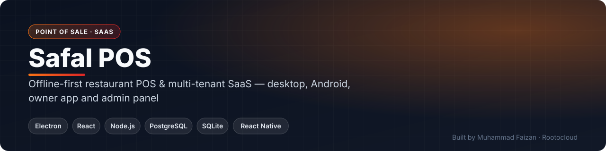</a>
  <a href="https://github.com/MuhammadFaizan73/safal-mart-pos">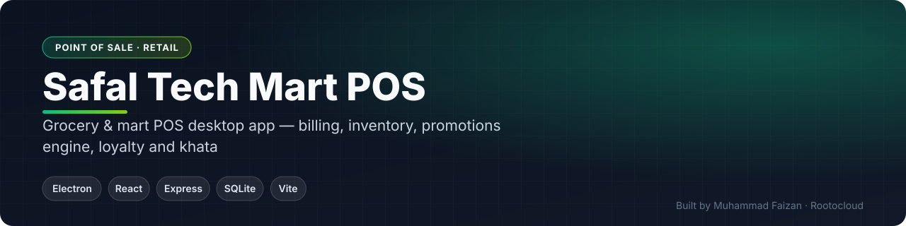</a>
  <a href="https://github.com/MuhammadFaizan73/medical-store-pos">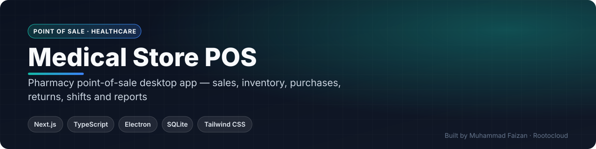</a>

### ☁️ SaaS Platforms

  <a href="https://github.com/MuhammadFaizan73/forma-gym-saas">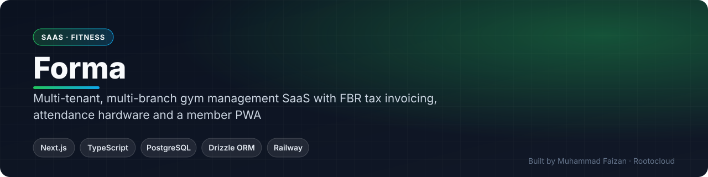</a>
  <a href="https://github.com/MuhammadFaizan73/school-management-saas">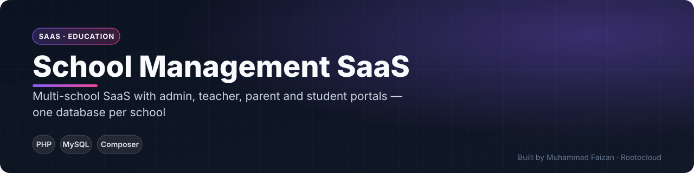</a>
  <a href="https://github.com/MuhammadFaizan73/safal-inventory-cloud">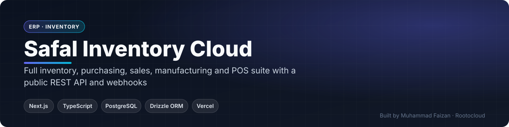</a>
  <a href="https://github.com/MuhammadFaizan73/restaurant-ordering-platform">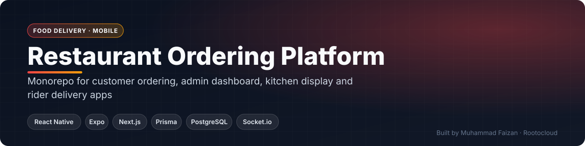</a>
  <a href="https://github.com/MuhammadFaizan73/hospital-management-system">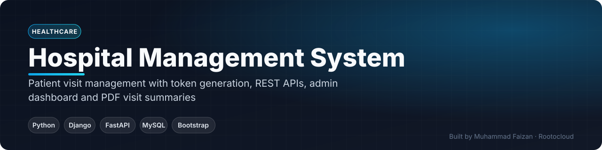</a>

### 🤖 AI Agents & Automation

  <a href="https://github.com/MuhammadFaizan73/whatsapp-ai-pos-trial-bot">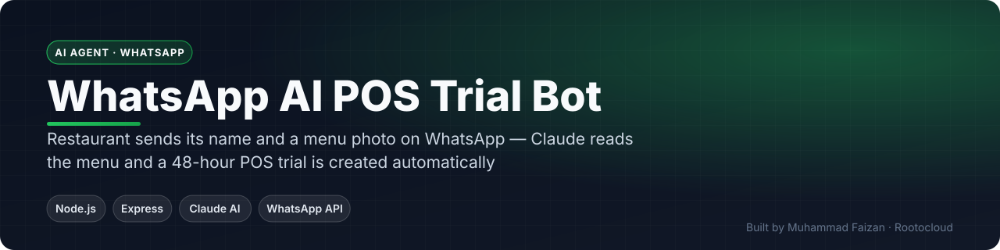</a>
  <a href="https://github.com/MuhammadFaizan73/lead-desk-crm">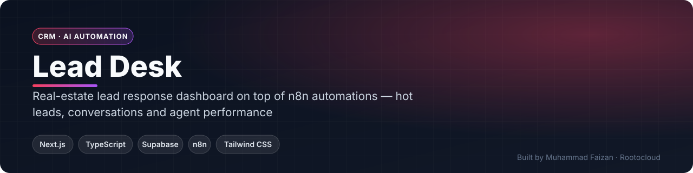</a>
  <a href="https://github.com/MuhammadFaizan73/google-meet-automation-bot">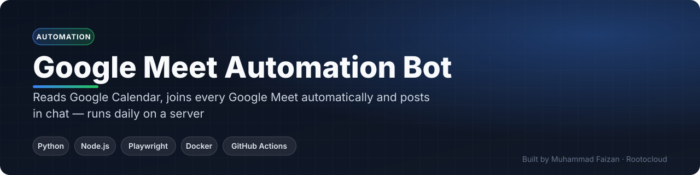</a>

### ⚙️ n8n AI Automations

  <a href="https://github.com/MuhammadFaizan73/whatsapp-ai-customer-support-agent">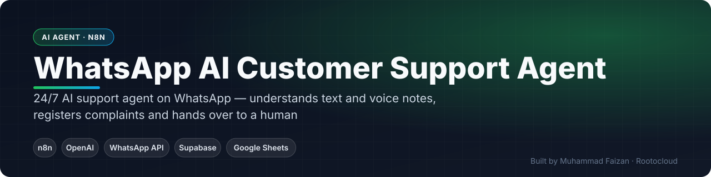</a>
  <a href="https://github.com/MuhammadFaizan73/whatsapp-ai-sales-order-agent">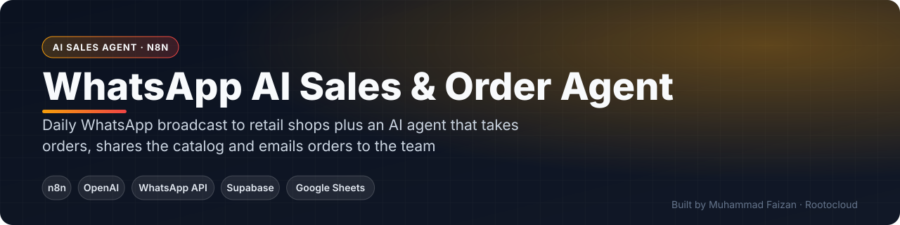</a>
  <a href="https://github.com/MuhammadFaizan73/ai-voice-calling-agent">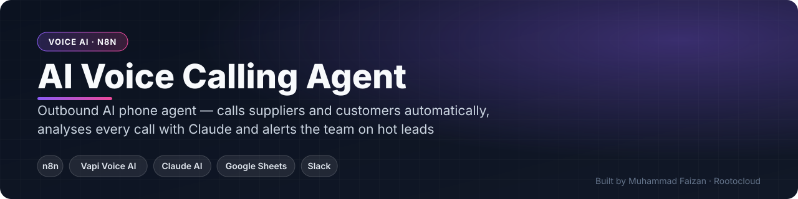</a>
  <a href="https://github.com/MuhammadFaizan73/real-estate-sms-lead-qualifier">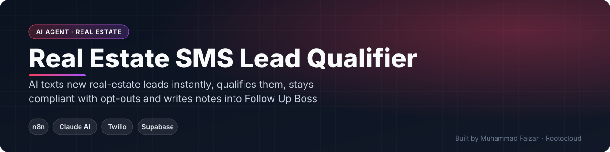</a>
  <a href="https://github.com/MuhammadFaizan73/immigration-consultant-ai-agent">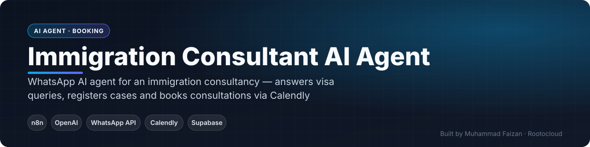</a>
  <a href="https://github.com/MuhammadFaizan73/restaurant-whatsapp-ordering-bot">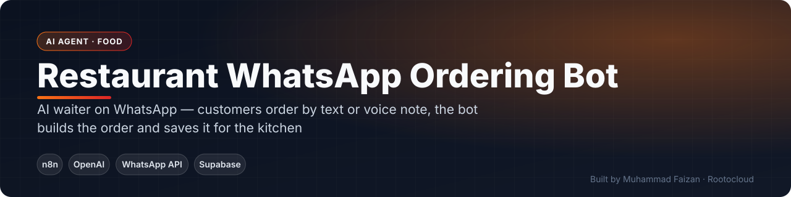</a>
  <a href="https://github.com/MuhammadFaizan73/software-sales-whatsapp-agent">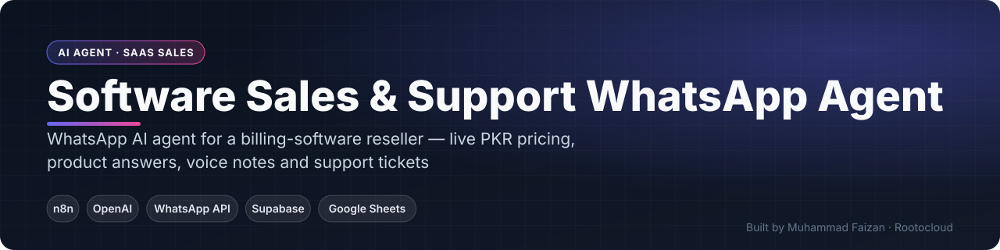</a>
  <a href="https://github.com/MuhammadFaizan73/linkedin-ai-content-autopilot">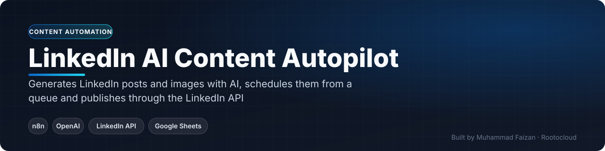</a>
  <a href="https://github.com/MuhammadFaizan73/ai-ebook-generator">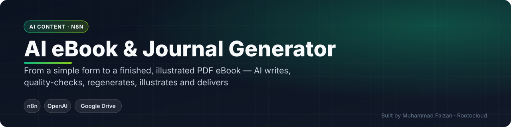</a>

> Most of these are commercial products, so their repositories document features and architecture while the source stays private. **Live demos available on request.**

## 🔥 Currently Working On

- 🧾 **Safal POS** — new features for restaurants: cloud sync, owner app and online ordering
- 🤖 **AI customer-support agents** on WhatsApp for businesses
- ⚙️ **n8n automation** projects for clients worldwide

## 💬 What Clients Say

<table>
<tr>
<td width="50%" valign="top">

⭐⭐⭐⭐⭐ 
<i>"Excellent experience working with this seller on my AI automation project. The work was delivered professionally, communication was smooth, and everything was handled with great attention to detail."</i>  
<b>Client · 🇺🇸 United States</b> — AI Automation

</td>
<td width="50%" valign="top">

⭐⭐⭐⭐⭐ 
<i>"Fantastic experience! Faizan is highly skilled, hardworking, and very professional. I'm happy to have worked with him and would definitely recommend his services."</i>  
<b>Client · 🇧🇩 Bangladesh</b> — Full-Stack Web App

</td>
</tr>
<tr>
<td width="50%" valign="top">

⭐⭐⭐⭐⭐ 
<i>"His services were beyond what was expected, always getting updates available, and the delivery was before the deadline."</i>  
<b>Client · 🇲🇦 Morocco</b> — Full-Stack Web App

</td>
<td width="50%" valign="top">

⭐⭐⭐⭐⭐ 
<i>"Faizan was very responsive and respectful; he listens and works diligently to deliver what you want on time."</i>  
<b>Client · 🇺🇸 United States</b> — Database / SQL

</td>
</tr>
<tr>
<td width="50%" valign="top">

⭐⭐⭐⭐⭐ 
<i>"Great experience working together. Fast communication and delivered earlier than expected. Highly recommended."</i>  
<b>Client · 🇧🇪 Belgium</b> — Development

</td>
<td width="50%" valign="top">

⭐⭐⭐⭐⭐ 
<i>"I truly appreciate his effort on the project and the speed with which he delivered it."</i>  
<b>Client · 🇸🇦 Saudi Arabia</b> — Database / SQL

</td>
</tr>
</table>

<a href="https://www.fiverr.com/faizan_develope"><b>See all reviews on Fiverr →</b></a>

## 🎓 Education

- 🎓 **Master's in Computer Science & Software Engineering**
- 📜 **3-Year Software Engineering Certification** — Aptech Education

## 📈 GitHub Activity

  

  <picture>
    <source media="(prefers-color-scheme: dark)" srcset="https://raw.githubusercontent.com/MuhammadFaizan73/MuhammadFaizan73/output/github-snake-dark.svg" />
    
  </picture>

## 🤝 Let's Work Together

Need an AI agent, an n8n automation, a SaaS product or a custom app for your business?

  
  
  

